# Gene Content Atlas

**Explore genomic diversity and gene-family distribution within a bacterial species.**

Gene Content Atlas is a local, dependency-free comparative genomics workspace and interactive exploration tool. It allows researchers and bioinformaticians to examine pangenome composition, inspect family-by-genome presence and copy-number variation, cluster strains by gene-content similarity, evaluate accumulation curves, and compare multi-genome cohorts.

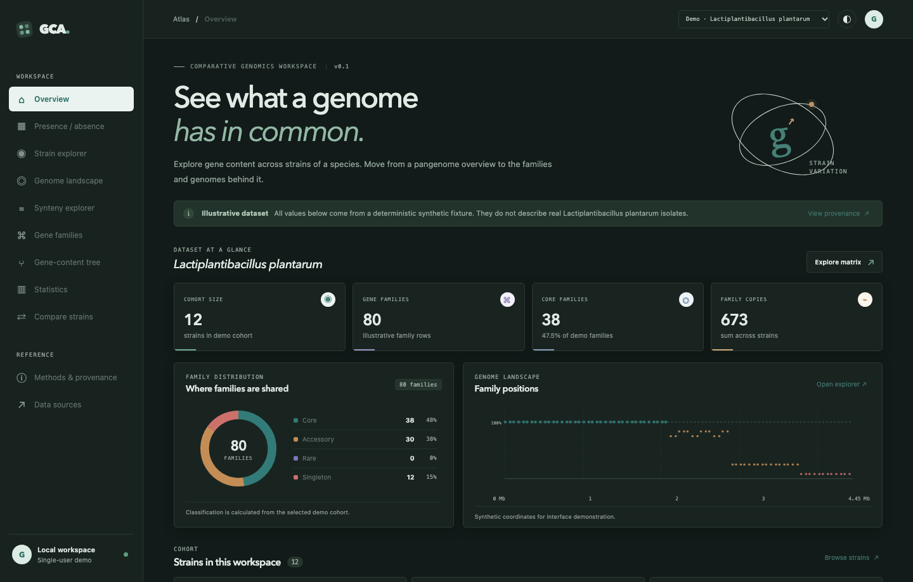

The application includes both a deterministic, zero-setup synthetic demonstration cohort and an automated pipeline for acquiring public NCBI RefSeq assemblies and importing strict-mode Panaroo pangenome matrices. Synthetic demonstration data is always labeled and never substituted for biological findings.

---

## Key Features

- **Interactive Presence / Absence Matrix:** Heatmap view of gene family distribution across strains with integer paralog copy counts, class filtering (Core, Accessory, Rare, Singleton), search, and family detail inspection.
- **Gene-Content Clustering:** Hierarchical UPGMA dendrogram constructed from pairwise binary Jaccard distances with leaf selection and Newick export.
- **Pangenome Statistics & Curves:** Real-time computation of the gene frequency spectrum, randomized genome-order accumulation curves, core-genome decay curves (with observed min/max ranges), and a pairwise Jaccard similarity matrix.
- **Multi-Genome Comparison:** Select 2 to 8 genomes from the tree or catalogue to calculate exact shared family counts, family unions, and strain-specific family sets.
- **Strain & Family Catalogues:** Tabular views of all cohort genomes and gene families with prevalence fractions, copy counts, assembly metadata, and filtering.
- **Dual Dataset Support:** Instant toggle between the deterministic demo fixture and real RefSeq/Panaroo pangenome analyses.
- **Transparent Provenance:** Clear visual distinction between gene-content clustering and sequence-based phylogeny; explicit scientific boundaries for unaligned loci and synteny.
- **Dependency-Free Local API:** Backend server written entirely in Python standard library with zero external runtime dependencies.
- **Export Formats:** Direct export of family matrices (TSV/CSV) and dendrograms (Newick syntax).

---

## Visual Tour

### Gene Family Presence / Absence Matrix

Search and filter thousands of gene families across the cohort. Selecting any row displays its exact prevalence, member genomes, and copy-number distribution in the inspection panel.

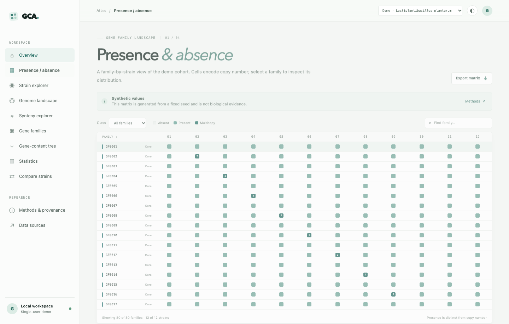

### Gene-Content Dendrogram (UPGMA Clustering)

Hierarchical clustering based on binary gene-family presence/absence Jaccard distance. Selecting leaves links directly to matrix filtering and strain comparison.

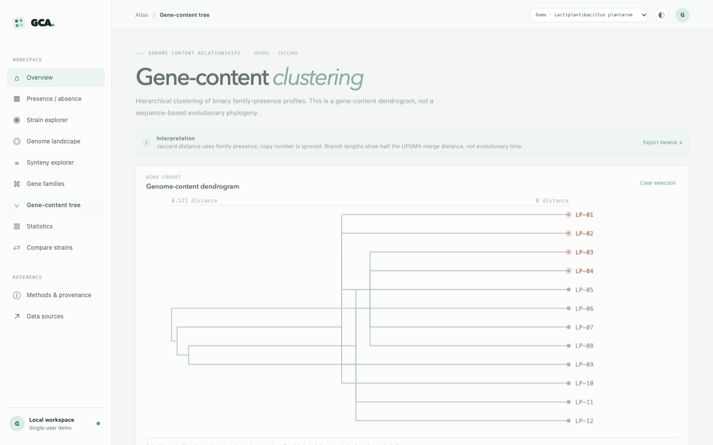

### Pangenome Statistics & Accumulation Curves

Computed from 100 seeded permutations of genome sampling order, showing family accumulation, core decay, frequency spectrum, and Jaccard similarity.

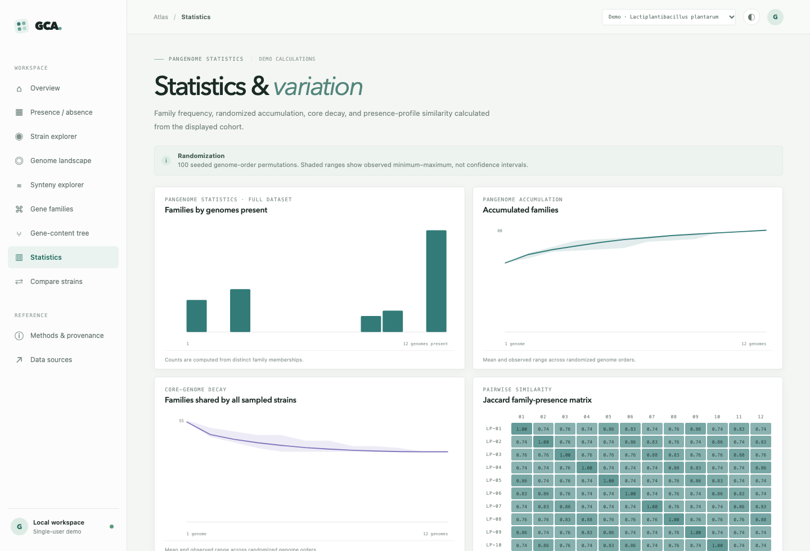

### Multi-Genome Comparison

Compare 2 to 8 genomes simultaneously to isolate core intersections, union sizes, strain-specific families, and pairwise Jaccard similarities.

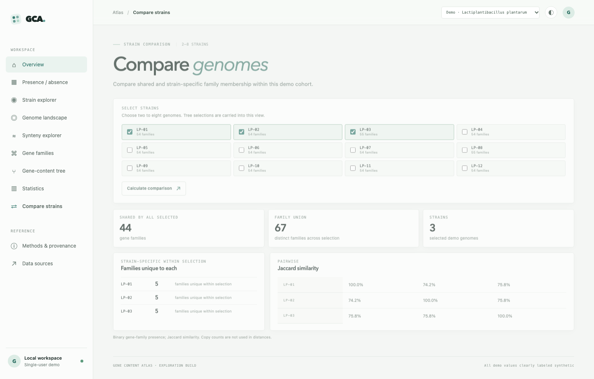

### Strain Catalogue & Genome Landscape

Explore cohort strain provenance, assembly accessions, gene counts, contig counts, and coordinate marker tracks.

|                 Strain Catalogue                  |                 Circular Coordinate Track                  |
| :-----------------------------------------------: | :--------------------------------------------------------: |
| 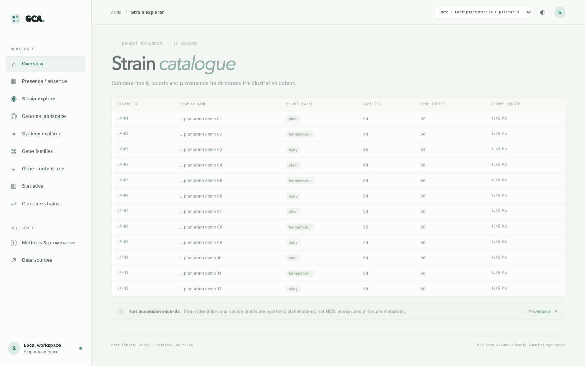 | 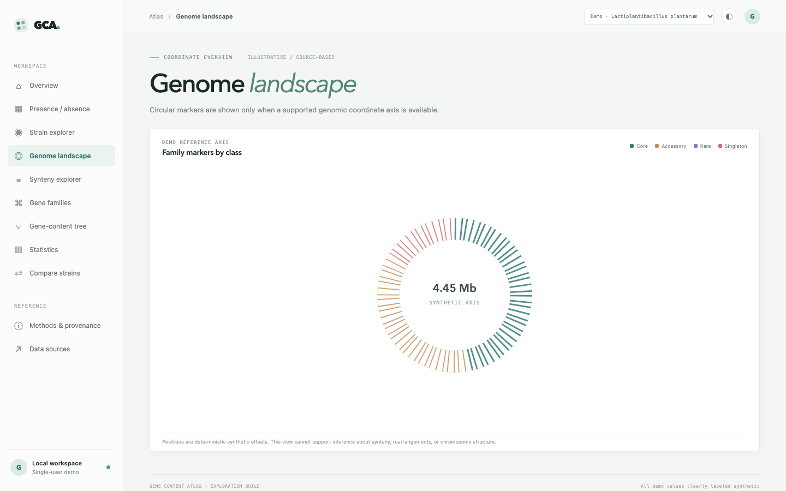 |

### Real RefSeq & Panaroo Analysis Mode

Seamlessly load and explore real RefSeq assemblies processed by Panaroo (e.g., 20 _Lactiplantibacillus plantarum_ genomes comprising 5,488 gene families).

|                       RefSeq Dataset Overview                        |                      RefSeq Panaroo Matrix                       |
| :------------------------------------------------------------------: | :--------------------------------------------------------------: |
| 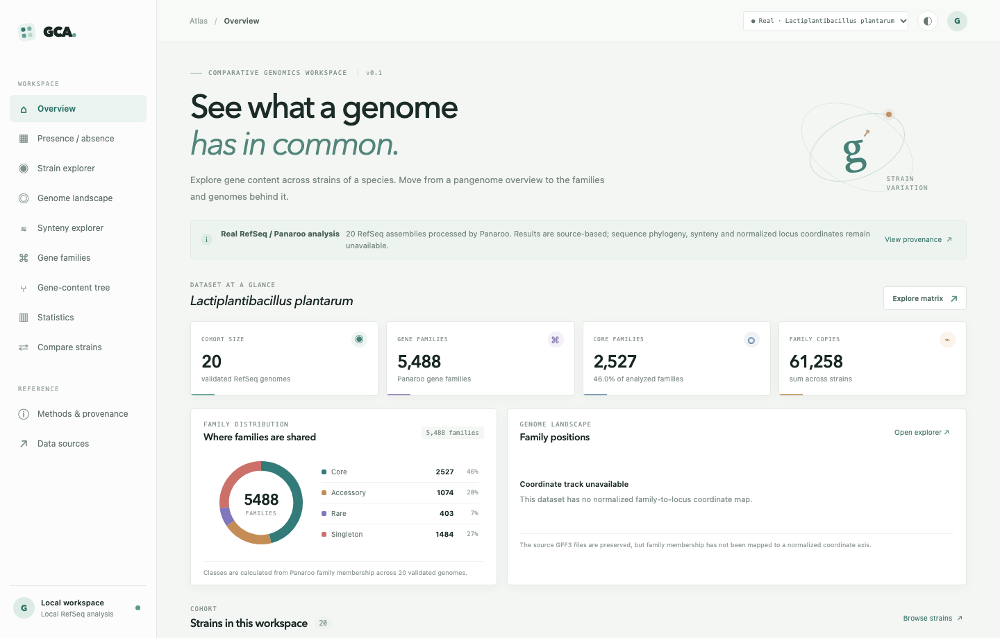 | 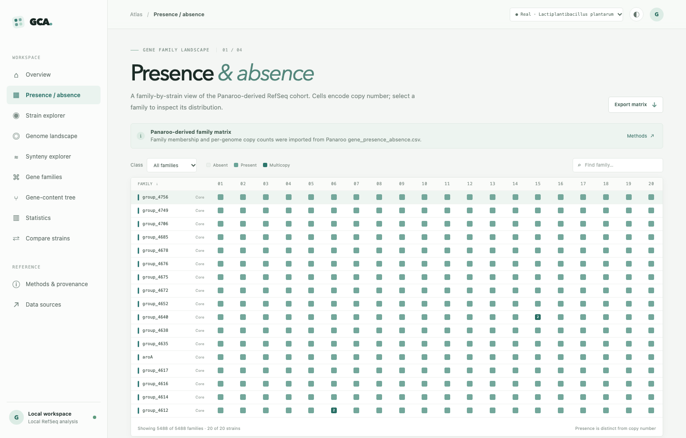 |

### Dark Mode Experience

Gene Content Atlas includes native dark mode support (toggled via the header icon, system preference, or `?theme=dark`), designed with high-contrast scientific color palettes for extended analysis sessions.

|                 Overview (Dark Mode)                 |      Presence / Absence Matrix (Dark Mode)       |
| :--------------------------------------------------: | :----------------------------------------------: |
|  | 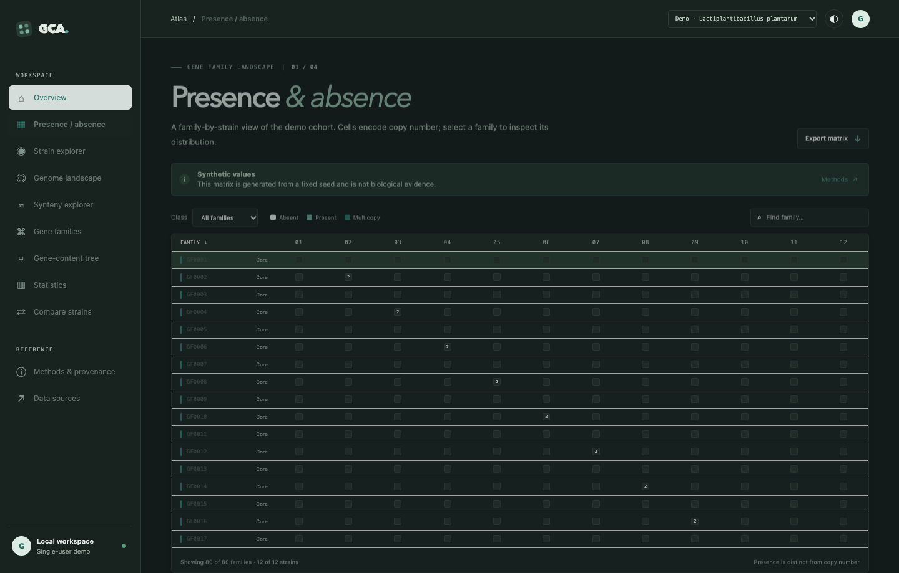 |

|        Gene-Content Tree (Dark Mode)         |             Pangenome Statistics (Dark Mode)             |
| :------------------------------------------: | :------------------------------------------------------: |
| 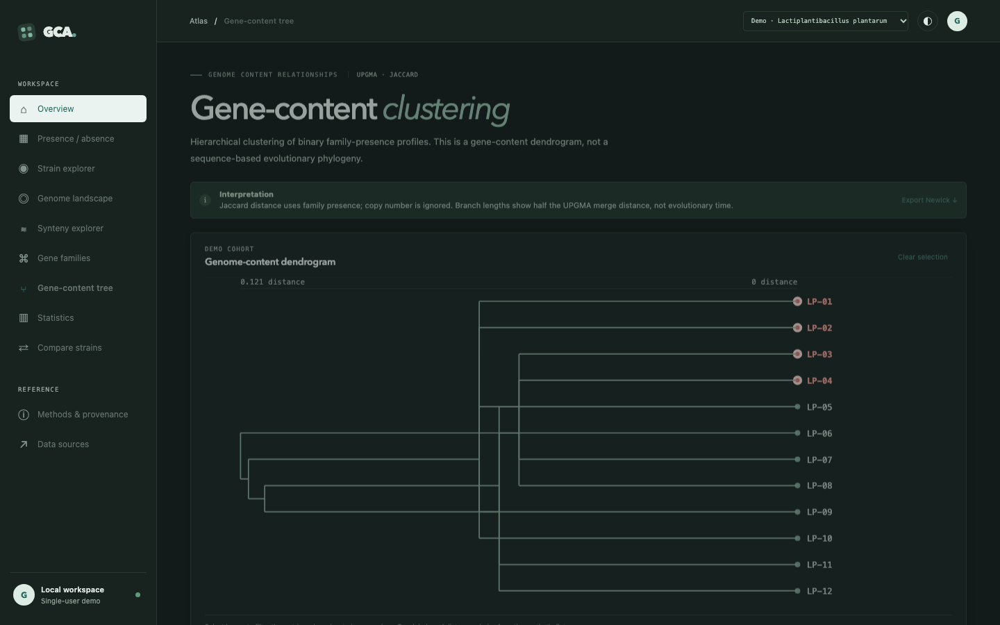 | 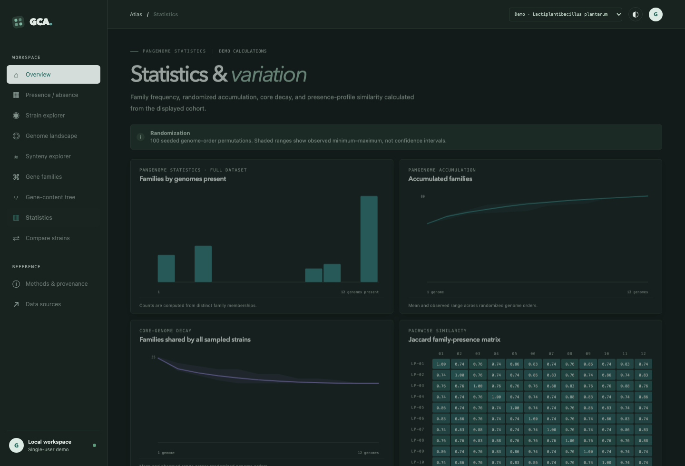 |

|          Multi-Genome Compare (Dark Mode)          |                       Real RefSeq Overview (Dark Mode)                        |
| :------------------------------------------------: | :---------------------------------------------------------------------------: |
| 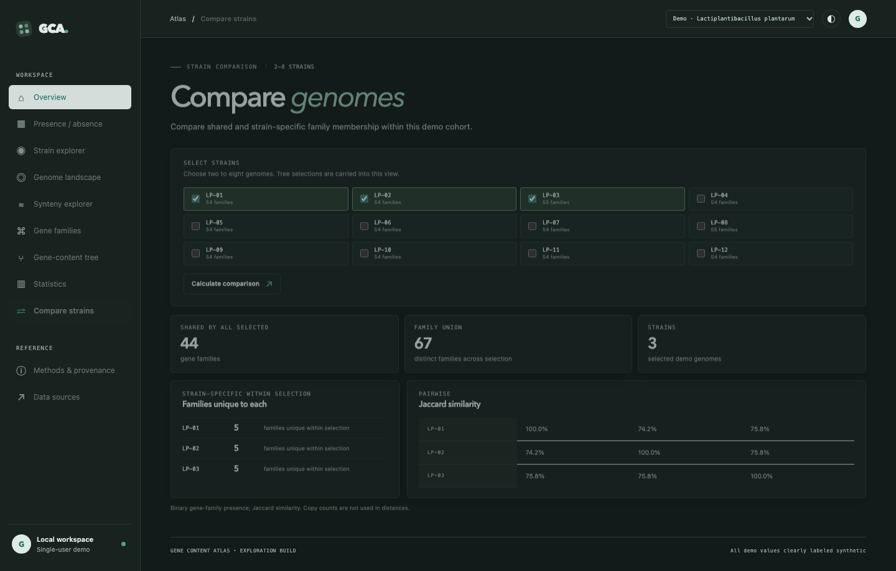 | 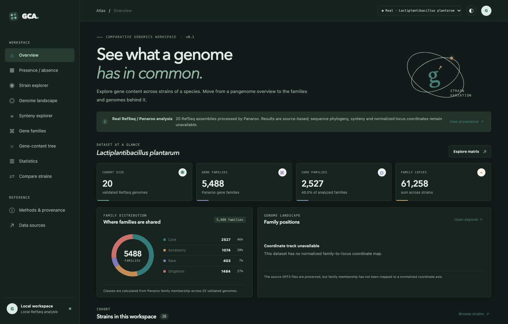 |

---

## Quick Start

### Prerequisites

- Python 3.10 or newer (tested with Python 3.10–3.14).
- Modern web browser (Chrome, Safari, Firefox, Edge).
- Optional: NCBI Datasets CLI and Panaroo for the real-data pipeline.

### Run with Make

```sh
make setup       # Check Python version
make seed-demo   # Generate deterministic demo fixture (data/demo.json)
make dev         # Start local server on http://127.0.0.1:8000
```

If port 8000 is occupied, set a custom port:

```sh
PORT=8765 make dev
```

### Run Directly with Python

If `make` is not available in your shell:

```sh
# Generate demo data fixture
python3 scripts/seed_demo.py

# Start local server
HOST=127.0.0.1 PORT=8000 python3 services/api/app.py
```

Then open [http://127.0.0.1:8000](http://127.0.0.1:8000) (or your chosen port) in your browser.

---

## Local Commands

| Target / Command   | Purpose                                                                     |
| :----------------- | :-------------------------------------------------------------------------- |
| `make setup`       | Verify Python runtime environment                                           |
| `make dev`         | Launch local HTTP server and static web app                                 |
| `make doctor`      | Inspect installed bioinformatics tools and storage status                   |
| `make seed-demo`   | Generate deterministic synthetic demo fixture (`data/demo.json`)            |
| `make test`        | Execute unit test suite across parsers, calculations, and API routes        |
| `make lint`        | Bytecode compile verification and frontend structure check                  |
| `make build`       | Run lint checks and verify static web assets                                |
| `make screenshots` | Capture automated high-resolution product showcase screenshots              |
| `make ingest-real` | Discover and download candidate RefSeq assemblies via NCBI Datasets         |
| `make analyze`     | Validate FASTA/GFF3, run Panaroo, and produce normalized pangenome artifact |

---

## Real RefSeq Workflow

To process and explore real biological data:

1. Install [NCBI Datasets CLI](https://www.ncbi.nlm.nih.gov/datasets/docs/v2/command-line-tools/download-and-install/) and [Panaroo](https://github.com/gtonkinhill/panaroo). Verify versions with `make doctor`.
2. Discover and acquire candidate assemblies:
   ```sh
   make ingest-real
   ```
   This ranks complete/chromosome/scaffold RefSeq candidates for the target species, excludes atypical isolates and clinical/hospital sources, and creates `data/real/selection_manifest.json` and `data/real/package/`.
3. Validate and cluster:
   ```sh
   make analyze
   ```
   This validates FASTA sequences and CDS coordinates against contig bounds, generates strict-mode Panaroo inputs, executes Panaroo, and compiles `data/real/analysis/pangenome.json`.
4. Launch `make dev` and select the **Real · Lactiplantibacillus plantarum** option in the dataset selector dropdown.

---

## REST API Reference

The local HTTP API serves the web interface and exposes the following endpoints:

| Method | Endpoint                                  | Description                                          |
| :----- | :---------------------------------------- | :--------------------------------------------------- |
| `GET`  | `/api/health`                             | Service status and default dataset                   |
| `GET`  | `/api/datasets`                           | List available datasets (demo and real artifacts)    |
| `GET`  | `/api/overview?dataset=...`               | Summary metrics, family classes, and strain counts   |
| `GET`  | `/api/matrix?dataset=...`                 | Family membership, copy counts, and prevalence       |
| `GET`  | `/api/strains?dataset=...`                | Genome catalogue and assembly metadata               |
| `GET`  | `/api/families?dataset=...`               | Complete gene family catalogue                       |
| `GET`  | `/api/similarity?dataset=...`             | Pairwise binary Jaccard similarity matrix            |
| `GET`  | `/api/tree?dataset=...`                   | UPGMA hierarchical tree and Newick string            |
| `GET`  | `/api/statistics?dataset=...&genomes=...` | Frequency spectrum, accumulation, and decay curves   |
| `POST` | `/api/compare`                            | Compare 2–8 selected genomes (shared, unique, union) |
| `GET`  | `/api/export/families.tsv?dataset=...`    | Download family matrix in TSV format                 |
| `GET`  | `/api/export/families.csv?dataset=...`    | Download family matrix in CSV format                 |
| `GET`  | `/api/export/tree.newick?dataset=...`     | Download gene-content tree in Newick format          |

### Example: Strain Comparison Request

```sh
curl -X POST http://127.0.0.1:8000/api/compare \
  -H "Content-Type: application/json" \
  -d '{"genome_ids": ["LP-01", "LP-02", "LP-03"], "dataset_id": "demo-lp-v1"}'
```

Response:

```json
{
  "genomes": ["LP-01", "LP-02", "LP-03"],
  "shared_family_count": 38,
  "union_family_count": 62,
  "unique_families": {
    "LP-01": ["GF0040", "GF0055"],
    "LP-02": ["GF0041"],
    "LP-03": ["GF0042", "GF0058"]
  },
  "pairwise_similarity": { ... },
  "metric": "Binary gene-family presence; Jaccard similarity. Copy counts are not used in distances."
}
```

---

## Methodology & Calculation Notes

- **Prevalence:** $\text{Prevalence}(F) = \frac{|\{g \in G \mid g \text{ possesses } F\}|}{|G|}$, where $G$ is the cohort.
- **Partitions:**
  - _Strict Core:_ Present in $100\%$ of genomes ($n$ of $n$).
  - _Soft Core:_ Present in $\ge 95\%$ but $< 100\%$ of genomes.
  - _Shell:_ Present in $\ge 15\%$ and $< 95\%$ of genomes.
  - _Cloud:_ Present in $\ge 2$ genomes and $< 15\%$ of genomes.
  - _Singleton:_ Present in exactly $1$ genome.
- **Distance Metric:** Pairwise distance is binary Jaccard distance: $D(A, B) = 1 - \frac{|A \cap B|}{|A \cup B|}$. Paralog copy counts do not alter presence/absence distances.
- **Gene-Content Tree:** Constructed via UPGMA clustering of Jaccard distances. _Note: This represents gene-content similarity and must not be interpreted as an evolutionary sequence phylogeny._
- **Accumulation & Decay Curves:** Computed using 100 seeded pseudo-random permutations of genome sampling order. Min/max envelopes indicate observed permutation ranges rather than parametric confidence intervals.

---

## Project Structure

```text
gene-content-atlas/
├── apps/
│   └── web/                   # Vanilla HTML5, CSS3, and JavaScript client
│       ├── app.js             # Client state, SVG renderers, interaction handlers
│       ├── index.html         # Accessible semantic workspace layout
│       └── styles.css         # Modern typography, data visualization, dark mode
├── services/
│   └── api/                   # Standard-library Python HTTP API
│       ├── analysis.py        # Jaccard, UPGMA, accumulation permutations
│       ├── app.py             # HTTP request router, static handler, exports
│       ├── ingest.py          # FASTA/GFF3 validation, Panaroo CSV parsing
│       └── tests/             # Comprehensive unit and integration tests
├── scripts/
│   ├── capture_screenshots.py # Headless browser screenshot generator
│   ├── check_frontend.py     # Structural frontend integrity validator
│   ├── doctor.py              # Environment and toolchain diagnostics
│   ├── ingest_real.py         # NCBI RefSeq assembly discovery and acquisition
│   ├── run_panaroo.py         # Input validation and Panaroo runner
│   └── seed_demo.py           # Deterministic demo fixture generator
├── data/
│   ├── demo.json              # Deterministic synthetic fixture (seed: 20261122)
│   └── real/                  # Real RefSeq package, manifest, and Panaroo output
├── docs/
│   └── screenshots/           # High-resolution showcase screenshots
└── Makefile                   # Unified developer task runner
```

---

## Verification & Testing

Run the test suite:

```sh
# Via Make
make test

# Or via Python directly
PYTHONPATH=services/api python3 -m unittest discover -s services/api/tests -v
```

The test suite covers:

- Deterministic synthetic fixture generation and class distributions.
- Jaccard similarity and UPGMA clustering consistency.
- Accumulation permutation stability and spectrum balance.
- GFF3 coordinate bounds validation, strand parsing, and frameshift handling.
- Panaroo Roary-style CSV matrix parsing and paralog copy counts.
- NCBI RefSeq candidate quality ranking and clinical exclusion logic.
- Path traversal rejection in zip package extraction.
- HTTP API route responses, security headers, query handling, and export formats.
- Real RefSeq/Panaroo artifact integrity verification.

---

## Current Scope & Limitations

- **Single-User Workspace:** Designed for local data exploration; does not require user accounts, authentication tokens, or external databases.
- **Synteny and Alignments:** The current release does not compute whole-genome synteny blocks or chromosomal rearrangement paths.
- **Sequence Phylogeny:** The dendrogram visualizes gene-family sharing (UPGMA), not sequence-based phylogenetics (e.g. core-genome SNP trees).
- **Taxonomy:** GTDB classification is not bundled; organism names reflect original RefSeq annotations.

---

## Contributing

Contributions, bug reports, and suggestions are welcome. Please ensure that all changes include corresponding unit tests and pass `make lint` and `make test`. See [CONTRIBUTING.md](CONTRIBUTING.md) and [CODE_OF_CONDUCT.md](CODE_OF_CONDUCT.md) for details.

---


## License & Custom Work

[](mailto:work@withrana.com) [](https://www.linkedin.com/in/workwithrana)
[](https://www.upwork.com/freelancers/~01bbcf6edb91a8df5f)
[](https://contra.com/ranajahanzaib/)

**License:** MIT, see [LICENSE](LICENSE). Free for personal and commercial use.

**Author:** Rana Jahanzaib

**Need this built for your stack?** Email me what you're working on: work@withrana.com
